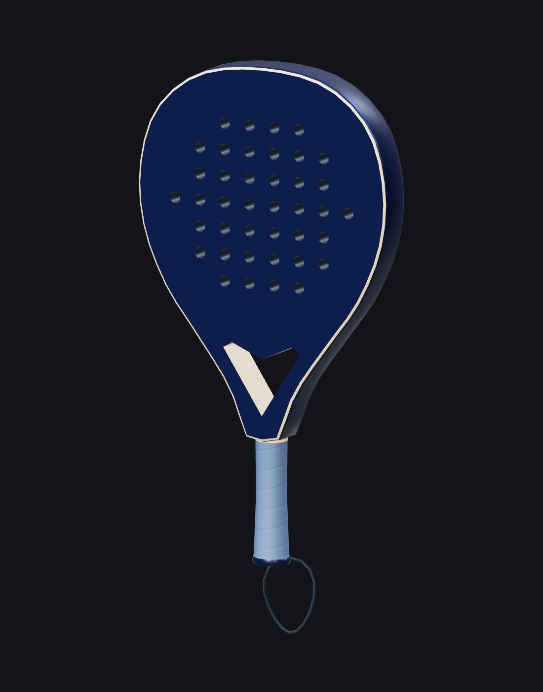

# T-A20-paleta — evidencia del asset Vibo

Modelado original en Blender, 2026-10-22. Fuente local en `assets-src/vibo/paleta.blend`; export sin compresión en `assets-src/vibo/paleta.glb`. Los binarios fuente no se versionan, según ADR-010.

## Vistas del GLB final en Three.js

- [Frente](./paleta-frente.png)
- [Perfil](./paleta-perfil.png)
- [Tres cuartos](./paleta-tres-cuartos.png)

## Resultado

- 2.340 triángulos; 144.028 bytes sin compresión; 1 malla / 2 primitivas y 2 materiales PBR.
- Normal map 512×512; color por vértice; 40 perforaciones reales, de 8 lados, para mantener el presupuesto.
- Cuerpo 45,5 × 25,18 × 3,8 cm. El bounding box con correa mide 51,84 cm de alto.
- Origen en el agarre, nodo glTF identidad, +Y hacia la cabeza y +Z hacia el frente.
- Malla conectada y cerrada: 0 bordes abiertos/no manifold, vértices sueltos y caras degeneradas; 0 modificadores pendientes.
- UV sin solapes superiores a `1e-9` de área. El residual máximo `1,11e-10` equivale a precisión numérica en bordes compartidos.
- Carga real mediante GLTFLoader/WebGL: 2.340 triángulos, escala y origen correctos, sin errores de página.

## Informes

- [Métricas](./paleta-metricas.json).
- [Topología en Blender](./paleta-validacion.json): registro anterior al ajuste de tolerancia; contabiliza un contacto numérico de área `1,11e-10` como solape con el umbral original de `1e-10`.
- [Auditoría independiente del GLB final](./paleta-glb-validacion.json): 0 solapes con tolerancia `1e-9`, cabecera glTF válida, sin compresión/animaciones/cámaras/luces.
- [Validación en Three.js](./paleta-web-validacion.json).

`npm run check` pasó durante el modelado: lint, typecheck (0 errores/avisos/hints), build y presupuestos. Build emite avisos sobre directivas MDX y tamaño de chunks; no se modificó código del sitio. `assets:check` no mide este GLB fuente: todavía no está publicado como salida optimizada en `public/models/`.

La integración al jugador, las variantes de calidad, el rendimiento de la escena y las capturas desktop/mobile por beat corresponden a T-A20.
